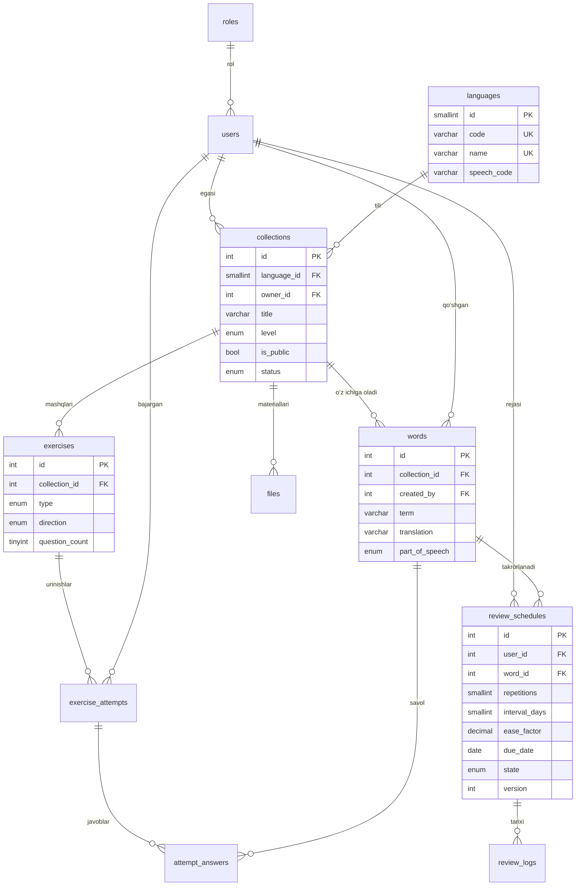

# Mustaqil ish hisoboti

**Fan:** Web dasturlashga kirish
**Mavzu:** Xorijiy tillarni o‘rganishga mo‘ljallangan web-sayt ishlab chiqish (A ilova, 32-mavzu: «Xorijiy til lug‘ati va takrorlash tizimi»)
**Loyiha nomi:** LinguaUz
**Bajardi:** ______________________ (guruh, F.I.Sh.)  **Qabul qildi:** ______________________

---

## 1. Texnik topshiriq (B ilova shakli)

| Band | Mazmuni |
|---|---|
| Mavzu | Xorijiy tillar lug‘atini intervalli takrorlash (SM-2) usulida o‘rganish web-ilovasi |
| Muammo | O‘quvchi yangi so‘zlarni tez unutadi; qaysi so‘zni qachon takrorlash kerakligini oddiy ro‘yxat ko‘rsatmaydi |
| Maqsad | So‘zlarni to‘plamlarda saqlash, mashqlar bilan tekshirish va har bir so‘z uchun shaxsiy takrorlash sanasini avtomatik hisoblash |
| Foydalanuvchilar | Mehmon (faqat ommaviy ma’lumotlarni ko‘radi); **O‘quvchi**; **Muharrir (o‘qituvchi)**; **Administrator** |
| Hisob yaratish tartibi | O‘quvchi o‘zi ro‘yxatdan o‘tadi (rol har doim «o‘quvchi»). Muharrir va administrator hisoblarini faqat administrator yaratadi yoki rolini o‘zgartiradi |
| To‘rtta mazmuniy bo‘lim | 1) **So‘zlar** — lug‘at; 2) **To‘plamlar** — mavzuli so‘z to‘plamlari; 3) **Mashqlar** — test va yozma tarjima; 4) **Takrorlash rejasi** — shaxsiy SM-2 jadvali |
| Asosiy ma’lumot obyektlari | Til, To‘plam, So‘z, Mashq, Mashq urinishi, Takrorlash yozuvi |
| To‘liq CRUD | **To‘plam** va **So‘z** (shuningdek Mashq, Til, Foydalanuvchi) |
| Asosiy funksional ssenariy | Javob natijasiga ko‘ra so‘zning navbatdagi takrorlash sanasini belgilash (4-bo‘limga qarang) |
| O‘chirish o‘rniga arxivlash | To‘plamdan boshqa foydalanuvchilar o‘rganayotgan bo‘lsa (takrorlash rejasi yoki mashq natijasi bor), to‘plam o‘chirilmaydi — **arxivlanadi** va faol ro‘yxatlardan chiqariladi; egasi uni qaytarishi mumkin. Shu tariqa o‘rganuvchilarning tarixi yo‘qolmaydi |

### Qabul shartlari
1. O‘quvchi to‘plamni tanlab «O‘rganishni boshlash» ni bossa, uning barcha so‘zlari rejaga qo‘shiladi; qayta bosilganda takroriy yozuv yaratilmaydi.
2. «Yaxshi» javobidan so‘ng keyingi takrorlash sanasi 1 → 6 → interval × osonlik koeffitsienti bo‘yicha oshadi; «Qayta» javobida ertangi kunga qaytadi.
3. Sanasi kelmagan so‘zga javob berilmaydi; bir kartaga ikki marta yuborilgan javob rad etiladi.
4. O‘quvchi boshqa o‘quvchining shaxsiy to‘plami, so‘zi, takrorlash yozuvi, mashq natijasi va faylini ko‘ra olmaydi va o‘zgartira olmaydi.
5. Mashqda xato topilgan so‘z qaytadan o‘rganishga o‘tadi va bugungi takrorlashga qo‘shiladi.
6. So‘zlar ro‘yxatining CSV eksporti ekrandagi filtr va saralash natijasiga teng bo‘ladi.

---

## 2. Ma’lumotlar modeli

### 2.1. ER-diagramma



Predmet jadvallari (minimum 3 talab): **languages, collections, words, exercises, exercise_attempts, attempt_answers, review_schedules, review_logs**.
Yordamchi jadvallar (hisobga kirmaydi): roles, users, login_attempts, files, contact_messages.

### 2.2. Ma’lumotlar lug‘ati (asosiy jadvallar)

**words** — so‘zlar (asosiy predmet jadvali, sinov yozuvlari: 64 ta)

| Ustun | Turi | Majburiy | Kalit / cheklov |
|---|---|---|---|
| id | INT UNSIGNED AI | ha | PK |
| collection_id | INT UNSIGNED | ha | FK → collections.id, ON DELETE CASCADE |
| created_by | INT UNSIGNED | ha | FK → users.id, ON DELETE RESTRICT |
| term | VARCHAR(120) | ha | UNIQUE(collection_id, term), INDEX |
| translation | VARCHAR(200) | ha | INDEX |
| transcription | VARCHAR(120) | yo‘q | — |
| part_of_speech | ENUM(noun, verb, adjective, adverb, phrase, other) | ha | standart: noun |
| example, example_translation | VARCHAR(500) | yo‘q | — |
| created_at, updated_at | DATETIME | ha / yo‘q | — |

**collections** — to‘plamlar (8 ta)

| Ustun | Turi | Majburiy | Kalit / cheklov |
|---|---|---|---|
| id | INT UNSIGNED AI | ha | PK |
| language_id | SMALLINT UNSIGNED | ha | FK → languages.id, RESTRICT (tilda to‘plam bo‘lsa til o‘chmaydi) |
| owner_id | INT UNSIGNED | ha | FK → users.id, RESTRICT |
| title | VARCHAR(150) | ha | UNIQUE(owner_id, title) |
| description | TEXT | yo‘q | — |
| level | ENUM(A1…C2) | ha | — |
| is_public | TINYINT(1) | ha | INDEX(status, is_public) |
| status | ENUM(active, archived) | ha | arxivlash uchun |

**review_schedules** — takrorlash rejasi (asosiy jarayon)

| Ustun | Turi | Majburiy | Kalit / cheklov |
|---|---|---|---|
| id | INT UNSIGNED AI | ha | PK |
| user_id | INT UNSIGNED | ha | FK → users.id CASCADE; UNIQUE(user_id, word_id) |
| word_id | INT UNSIGNED | ha | FK → words.id CASCADE |
| repetitions | SMALLINT | ha | ketma-ket to‘g‘ri javoblar soni |
| interval_days | SMALLINT | ha | oxirgi interval |
| ease_factor | DECIMAL(4,2) | ha | CHECK 1.30–5.00, standart 2.50 |
| due_date | DATE | ha | INDEX(user_id, due_date) |
| state | ENUM(new, learning, review, mastered) | ha | — |
| version | INT UNSIGNED | ha | takroriy so‘rovni aniqlash (optimistik qulf) |

**exercises** (6 ta), **languages** (6 ta), **exercise_attempts / attempt_answers**, **review_logs** — `database/schema.sql` da izohlar bilan.

### 2.3. O‘chirishdagi bog‘liqlik qoidalari
- To‘plam o‘chirilsa — so‘zlar, mashqlar, fayl yozuvlari CASCADE bilan o‘chadi, diskdagi fayllar dastur tomonidan o‘chiriladi. Ammo boshqa o‘rganuvchilari bo‘lsa — **arxivlanadi**.
- So‘z o‘chirilsa — unga tegishli takrorlash yozuvlari va javoblar ham o‘chadi (foydalanuvchiga ogohlantirish chiqadi).
- Tilda to‘plam bo‘lsa, til o‘chirilmaydi (RESTRICT). Foydalanuvchi o‘chirilmaydi, balki **bloklanadi**.

---

## 3. Arxitektura (sof PHP, MVC)

| Qatlam | Vazifasi | Misol |
|---|---|---|
| `public/index.php` | yagona kirish nuqtasi | barcha so‘rovlar shu yerga keladi |
| `app/Core/Router.php` | manzil va usulga mos kontroller amalini tanlaydi; 404 / 405 | `POST /words/{id}/delete → WordController::destroy` |
| Controller | rol, egalik, CSRF va qiymatlarni tekshiradi, modelga murojaat qiladi | `WordController::store()` |
| Model | PDO orqali parametrli SQL, predmet qoidalari, tranzaksiyalar | `Review::answer()` |
| View | faqat HTML chiqaradi (`e()` = `htmlspecialchars`), SQL yo‘q | `app/Views/words/form.php` |

### «So‘z qo‘shish» so‘rovining yo‘li
1. Brauzer `POST /words` yuboradi (forma + CSRF token).
2. `Router` → `WordController::store()`.
3. Kontroller: `requireAuth()` (tizimga kirganmi) → `verifyCsrf()` → `Validator` (majburiy maydonlar, uzunlik, ENUM qiymat) → tanlangan to‘plam mavjudligi va unga **yozish huquqi** (`Policy::canEditCollection`) → so‘z takrorlanmasligi.
4. `Word::create()` — `INSERT ... VALUES (:col, :uid, :term, ...)` PDO parametrlari bilan.
5. Muvaffaqiyatda `303` qayta yo‘naltirish va flash-xabar; xatoda forma 422 kodi va xatolar bilan qayta chiqariladi.

O‘zgartirish va o‘chirish faqat **POST** orqali; GET bilan urinish `405` qaytaradi.

---

## 4. Asosiy funksional jarayon: takrorlash sanasini belgilash

**Boshlanish sharti:** foydalanuvchi tizimga kirgan va to‘plamni «O‘rganishni boshlash» orqali rejaga qo‘shgan (`INSERT IGNORE` — UNIQUE(user_id, word_id) takrorni oldini oladi).

**Holatlar va o‘tishlar:**
```
new ──(javob ≥3)──▶ learning ──(2-to‘g‘ri javob)──▶ review ──(interval ≥ 21 kun)──▶ mastered
  ▲                    ▲                                │                               │
  └────────────────────┴───────(javob «Qayta» yoki mashqdagi xato)─────────────────────┘
```

**Algoritm (SM-2, `App\Models\Review::compute`):**
- Sifat q ∈ {1 Qayta, 3 Qiyin, 4 Yaxshi, 5 Oson}.
- q < 3 → takrorlar = 0, interval = 1 kun.
- aks holda takrorlar + 1; interval = 1 (1-marta), 6 (2-marta), keyin `round(interval × EF)`.
- EF = EF + (0.1 − (5 − q)·(0.08 + (5 − q)·0.02)), kamida 1.3.
- Keyingi sana = bugun + interval.

**Tranzaksiya va takroriy so‘rov (`Review::answer`):**
1. `SELECT ... FOR UPDATE WHERE id = ? AND user_id = ?` — yozuv qulflanadi, begona yozuv topilmaydi.
2. Forma bilan kelgan `version` bazadagiga teng bo‘lmasa — «javob allaqachon qabul qilingan» (ikki marta bosish, ikkinchi tab).
3. `due_date > bugun` bo‘lsa — rad etiladi.
4. `UPDATE ... SET ..., version = version + 1 WHERE id = ? AND version = ?` va `review_logs` ga yozuv — ikkalasi bitta tranzaksiyada.

**JavaScript:** kartadagi har bir tugmada xuddi shu formula bilan keyingi interval oldindan ko‘rsatiladi (masalan, «Yaxshi · 6 kun»).

**Mashq bilan bog‘lanish:** mashq savollari serverda sessiyada saqlanadi, bir martalik token bilan qabul qilinadi; xato javob berilgan so‘zlar tranzaksiya ichida `repetitions = 0`, `due_date = bugun` holatiga o‘tkaziladi.

---

## 5. Foydalanuvchilar va vakolatlar

| Amal | Administrator | Muharrir | O‘quvchi | Mehmon |
|---|---|---|---|---|
| Hisoblar va rollarni boshqarish | ✔ | ✘ | ✘ | ✘ |
| Tillar ro‘yxatini boshqarish | ✔ | ✘ | ✘ | ✘ |
| Ommaviy to‘plam yaratish | ✔ | ✔ | ✘ (faqat shaxsiy) | ✘ |
| To‘plam / so‘z / mashq / fayl CRUD | barchasi | faqat o‘zi yaratgan | faqat o‘z shaxsiy to‘plami | ✘ |
| Ommaviy ma’lumotlarni ko‘rish | ✔ | ✔ | ✔ | ✔ |
| Takrorlash rejasi, mashq bajarish | ✔ (o‘zi uchun) | ✔ | ✔ | ✘ |
| Mashq natijasini ko‘rish | barchasi | o‘ziniki | o‘ziniki | ✘ |
| So‘zlar CSV eksporti | ko‘rinadigan barcha yozuvlar | ko‘rinadiganlar | ko‘rinadiganlar | ✘ |
| Aloqa xabarlarini ko‘rish | ✔ | ✘ | ✘ | ✘ |

Har bir himoyalangan so‘rovda rol (`requireRole`) va yozuv egasi (`Policy`) **serverda** tekshiriladi. Boshqa foydalanuvchining shaxsiy yozuviga murojaat `404` qaytaradi (yozuv mavjudligi ham oshkor qilinmaydi), ruxsatsiz amal — `403`.

---

## 6. Axborot xavfsizligi

| Xavf | Qo‘llangan chora | Kod joyi |
|---|---|---|
| SQL inyeksiya | barcha qiymatlar PDO parametrlari (`EMULATE_PREPARES = false`); saralash ustuni oq ro‘yxatdan (`Word::SORTS`) | `app/Models/*` |
| XSS | har bir chiqish `e()` = `htmlspecialchars(ENT_QUOTES)`; Content-Security-Policy (`script-src 'self'`) | `helpers.php`, `bootstrap.php` |
| CSRF | sessiyadagi 256-bitli token, `hash_equals` bilan tekshiriladi; cookie `SameSite=Lax` | `Csrf.php`, `Controller::verifyCsrf` |
| Parollar | `password_hash()` / `password_verify()`, kerak bo‘lsa `password_needs_rehash` | `User.php`, `AuthController` |
| Sessiya | `HttpOnly`, `SameSite`, HTTPS da `Secure`; kirishda va chiqishda `session_regenerate_id(true)`; `use_strict_mode` | `Session.php`, `Auth.php` |
| Parolni tanlab topish | 15 daqiqada 5 tadan ortiq noto‘g‘ri urinish (IP yoki pochta bo‘yicha) bloklanadi; umumiy xabar «pochta yoki parol noto‘g‘ri» | `LoginAttempt.php` |
| Fayl yuklash | kengaytma oq ro‘yxati + `finfo` MIME + rasm uchun `getimagesize`; hajm chegarasi; tasodifiy nom; `public/` dan tashqarida saqlash; yuklab olishda huquq tekshiruvi | `Uploader.php`, `FileController` |
| Aloqa formasi spami | IP bo‘yicha 10 daqiqada 3 ta xabar; yashirin «honeypot» maydon; qabul qiluvchi manzil faqat server sozlamasida | `ContactController` |
| CSV formula inyeksiyasi | `= + - @` bilan boshlangan katakka `'` qo‘shiladi | `Csv::safe` |
| Maxfiy sozlamalar | `config/config.php` `.gitignore` da, `config/` va `storage/` tashqaridan yopiq; ish muhitida xato tafsiloti ko‘rsatilmaydi, faqat `storage/logs/app.log` ga yoziladi | `ErrorHandler.php`, `.htaccess` |

---

## 7. Interfeys

- Semantik HTML: `header`, `nav`, `main`, `footer`, `article`, `section`, `figure`; barcha maydonlarda `label`, rasmlarda `alt`; «Asosiy mazmunga o‘tish» havolasi; jadvallarda `caption`, `aria-sort`.
- Moslashuvchan CSS (kutubxonasiz): 360 px — bir ustun va yig‘iladigan menyu; 768 px — ikki ustun; 1024+ px — uch ustun. Sahifa 360 px da gorizontal aylantirishsiz ochiladi.
- JavaScript imkoniyatlari: (1) forma tekshiruvi (majburiy, uzunlik, email, son oralig‘i, parol tasdig‘i, fayl hajmi/turi); (2) jadval va kartalarda jonli filtr, filtr tanlanganda avtomatik yuborish; (3) SM-2 bo‘yicha keyingi intervalni hisoblash, mashqda javoblar progressi va taymer; qo‘shimcha — Web Speech API orqali talaffuz, klaviatura yorliqlari (Space, 1–4).
- JavaScript o‘chirilgan bo‘lsa ham barcha formalar ishlaydi va server tekshiruvi saqlanadi.

---

## 8. Joylashtirish

1. Server ildizi `public/` ga yo‘naltiriladi (yoki ildizdagi `.htaccess` orqali).
2. `config/`, `storage/`, `database/`, `app/` uchun `Require all denied`.
3. Global muhitda HTTPS yoqiladi (sessiya cookie avtomatik `Secure` bo‘ladi).
4. Baza zaxirasi: `mysqldump` → yangi bazaga import → yozuvlar soni solishtiriladi (sinov bayonnomasi, T-17).
5. Ommaviy sahifalarda `<title>`, `meta description`, sarlavhalar ierarxiyasi; kabinet, boshqaruv va takrorlash sahifalarida `noindex`; `robots.txt`.

**Ishchi manzil:** ______________________ (boshqa qurilmadan ochilgan ekran tasvirini ilova qiling)

---

## 9. Foydalanilgan vositalar

| Vosita | Versiya | Vazifasi | Manba |
|---|---|---|---|
| PHP | 8.3 | server dasturi | https://www.php.net |
| MariaDB (XAMPP) | 10.11 | ma’lumotlar bazasi | https://mariadb.org |
| XAMPP | 8.x | lokal Apache + MySQL | https://www.apachefriends.org |
| Mailpit (ixtiyoriy) | 1.x | lokal SMTP sinov qutisi | https://mailpit.axllent.org |

Tashqi PHP yoki JavaScript kutubxonalari, frameworklar va CMS ishlatilmagan. SMTP mijoz, yo‘naltiruvchi, validatsiya va CSV eksport sof PHP da yozilgan.

## 10. Adabiyotlar
1. PHP qo‘llanmasi: Password Hashing — https://www.php.net/manual/en/book.password.php
2. PHP qo‘llanmasi: PDO prepared statements — https://www.php.net/manual/en/pdo.prepared-statements.php
3. OWASP Cheat Sheet Series: XSS, CSRF, Session Management — https://cheatsheetseries.owasp.org
4. OWASP File Upload Cheat Sheet — https://cheatsheetseries.owasp.org/cheatsheets/File_Upload_Cheat_Sheet.html
5. P. Wozniak. SuperMemo SM-2 algoritmi tavsifi — https://super-memory.com/english/ol/sm2.htm
6. MDN Web Docs: HTML, CSS, JavaScript — https://developer.mozilla.org
